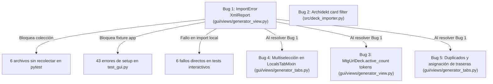

# Plan de Corrección Paso a Paso para la Suite de Pruebas

Este documento detalla el análisis de causa raíz y el plan de ejecución por tareas para solucionar todos los fallos y errores detectados en la suite de pruebas (`pytest`).

---

## 1. Mapa de Dependencias y Causa Raíz



---

## 2. Tareas de Corrección Paso a Paso

### Tarea 1: Desacoplar y corregir importación de `XmlReport`
* **Archivos**:
  - `gui/views/generator_view.py`
  - `src/validator.py`
* **Diagnóstico**:
  `XmlReport` pertenece a `src/precheck.py`. En `generator_view.py:81` se importa desde `src.validator`, provocando un `ImportError` en cascada.
* **Acciones sugeridas**:
  1. En `gui/views/generator_view.py`:
     ```python
     # Líneas 66-73: añadir XmlReport al bloque de src.precheck
     from src.precheck import (
         analyze,
         check_drive_access,
         collect_drive_ids,
         format_warning,
         plan,
         write_manifest,
         XmlReport,
     )
     # Línea 81: importar solo ValidationWarning
     from src.validator import ValidationWarning
     ```
  2. En `src/validator.py`:
     Reexportar `XmlReport` por compatibilidad defensiva:
     ```python
     from src.precheck import XmlReport
     __all__ = ["ValidationWarning", "validate", "XmlReport"]
     ```
* **Criterio de verificación**:
  - `python -m pytest tests/test_app_single_window.py tests/test_generator_and_validator_views.py tests/test_hub_and_settings_views.py tests/test_inventory_view.py tests/test_moxfield_validator.py tests/test_views_corner_cases.py -q` se recolectan sin `ImportError`.

---

### Tarea 2: Restaurar filtrado de cartas incompletas en Archidekt
* **Archivo**:
  - `src/deck_importer.py`
* **Diagnóstico**:
  En `_fetch_archidekt`, se cambió la condición de filtrado a `if not name: continue`. Cuando Archidekt devuelve entradas sin `editioncode` o sin `collectorNumber`, la carta no se descarta, causando que `len(deck.cards)` sea 2 en lugar de 1 en el test.
* **Acción sugerida**:
  Modificar la validación en `src/deck_importer.py:_fetch_archidekt`:
  ```python
  if not name or not set_code or not collector_number:
      continue
  ```
* **Criterio de verificación**:
  - `python -m pytest tests/test_deck_importer_corner_cases.py -k test_archidekt_error_and_types_array -v` pasa correctamente.

---

### Tarea 3: Corregir conteo unitario de tokens en `MtgUrlDeck.active_count`
* **Archivo**:
  - `gui/views/generator_view.py`
* **Diagnóstico**:
  Al calcular `active_count`, cada versión única de token debe sumar 1 slot (`token_count += 1`), tal como esperan las reglas de deduplicación y las aserciones de `test_active_count_deduplicates_tokens`. El código sumaba erróneamente `c.quantity`.
* **Acción sugerida**:
  En `gui/views/generator_view.py`:
  ```python
  if key not in seen_tokens:
      seen_tokens.add(key)
      token_count += 1
  ```
* **Criterio de verificación**:
  - `python -m pytest tests/test_gui.py -k test_active_count -v` pasa sin discrepancia en el conteo.

---

### Tarea 4: Implementar motor de multiselección en `LocalsTabMixin`
* **Archivo**:
  - `gui/views/generator_tabs.py`
* **Diagnóstico**:
  El checkbutton de multiselección conecta `command=self._on_front_multiselect_changed`, pero dicho método y sus funciones auxiliares (`_front_change_indices`, `_on_front_selection_start`, `_on_front_selection_drag`, `_update_front_selection_colors`) faltan en `LocalsTabMixin`.
* **Acciones sugeridas**:
  1. Implementar en `LocalsTabMixin`:
     ```python
     def _on_front_multiselect_changed(self) -> None:
         if not self._front_multiselect_var.get():
             self._front_selected_indices.clear()
             self._refresh_front_rows()

     def _front_change_indices(self, idx: int) -> list[int]:
         if 0 <= idx < len(self.state.local_fronts):
             if idx in self._front_selected_indices:
                 return sorted(i for i in self._front_selected_indices if i < len(self.state.local_fronts))
             return [idx]
         return []

     def _on_front_selection_start(self, idx: int) -> str | None:
         if not self._front_multiselect_var.get():
             return None
         self._front_selected_indices.add(idx)
         self._update_front_selection_colors()
         return "break"

     def _on_front_selection_drag(self, idx: int) -> str | None:
         if not self._front_multiselect_var.get():
             return None
         self._front_selected_indices.add(idx)
         self._update_front_selection_colors()
         return "break"

     def _update_front_selection_colors(self) -> None:
         for idx, row in enumerate(self._front_rows):
             selected = idx in self._front_selected_indices
             color = "#cfe8ff" if selected else "#f0f0f0"
             highlight = "#5a9bd4" if selected else "#f0f0f0"
             row["frame"].configure(bg=color, highlightbackground=highlight)
             for widget in row.get("selection_widgets", []):
                 widget.configure(bg=color)
     ```
  2. Actualizar `_on_front_crop_change` y `_on_front_back_change` para aplicar cambios a todos los índices devueltos por `self._front_change_indices(idx)`.
  3. En `_refresh_front_rows`, almacenar `selection_widgets` y vincular los eventos de clic (`<ButtonPress-1>` / `<B1-Motion>`) a `_on_front_selection_start` y `_on_front_selection_drag`.
* **Criterio de verificación**:
  - `python -m pytest tests/test_gui.py -k "TestFrontMultiselection or TestCropChange" -v` pasa sin errores ni excepciones.

---

### Tarea 5: Permitir imágenes duplicadas en drop y preservar asignaciones de traseras
* **Archivo**:
  - `gui/views/generator_tabs.py`
* **Diagnóstico**:
  - `_on_drop_fronts` y `_on_drop_backs` filtran con `if pp not in self.state.local_fronts`, impidiendo duplicados paralelos requeridos cuando un usuario arrastra varias copias de una misma carta.
  - En `_remove_back(idx)`, se desasignan las traseras comparando `if assigned == removed_path: self.state.front_back_paths[i] = None`. Si queda otra copia idéntica del reverso en `local_backs`, se debe conservar la asignación.
* **Acciones sugeridas**:
  1. En `_on_drop_backs`: eliminar el filtro `if pp not in self.state.local_backs` y permitir añadir todas las rutas con extensión válida.
  2. En `_on_drop_fronts`: eliminar el filtro `if pp not in self.state.local_fronts` y añadir cada imagen manteniendo las listas paralelas en sincronía.
  3. En `_remove_back(idx)`:
     ```python
     del self.state.local_backs[idx]
     del self.state.local_back_crop[idx]
     for i, assigned in enumerate(self.state.front_back_paths):
         if assigned not in self.state.local_backs:
             self.state.front_back_paths[i] = None
     ```
* **Criterio de verificación**:
  - `python -m pytest tests/test_gui.py -k TestDuplicateLocalImages -v` pasa completamente.

---

### Tarea 6: Verificación completa y aseguramiento de calidad
* **Comandos de ejecución**:
  ```bash
  .venv/bin/python -m pytest tests/ --ignore=tests/test_downloader.py -m "not network" -q
  .venv/bin/python -m pytest tests/test_downloader.py -m "not network" -q
  .venv/bin/python -m ruff check .
  .venv/bin/python -m ruff format --check .
  ```
* **Criterio de aceptación**:
  - 845 pruebas ejecutadas y aprobadas (100% pass rate).
  - 0 fallos, 0 errores.
  - Conformidad con `ruff` sin advertencias de formato ni linter.
