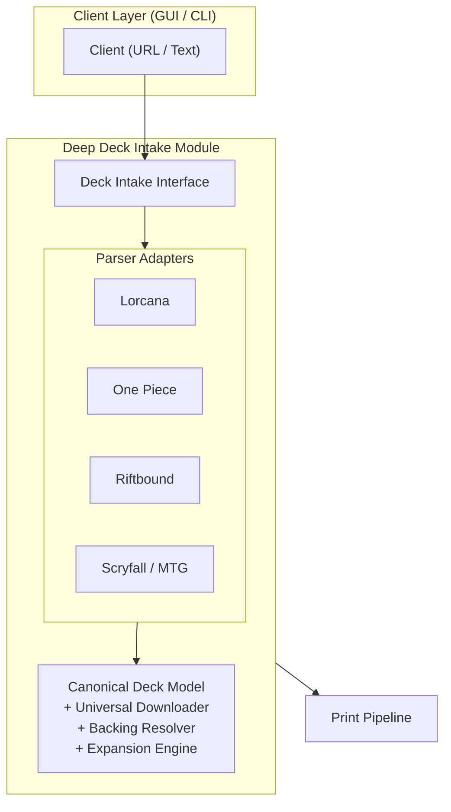
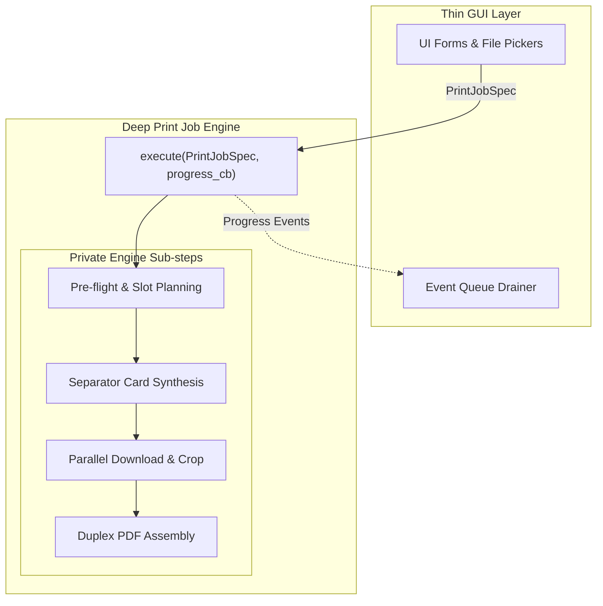
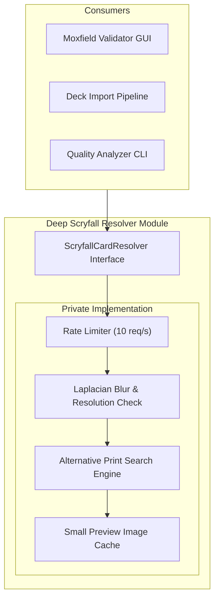

# Codebase Architecture Review & Deepening Opportunities

_Date: August 2026_  
_Domain context: [CONTEXT.md](../CONTEXT.md)_

This document records the architectural friction identified across the MPCFillToPDF codebase and details four proposed **deepening opportunities** to transform shallow modules into deep ones with well-defined seams.

---

## Architectural Principles & Shared Vocabulary

- **Module**: A unit of code with an **interface** and an **implementation**.
- **Interface**: The test surface and boundary through which callers interact with a module.
- **Depth**: A module is deep when its interface is small and simple relative to the power and complexity of its hidden implementation. A module is shallow when its interface is nearly as complex as its implementation.
- **Seam**: A clear boundary where an implementation can be replaced, substituted, or adapted (e.g., between core business logic and external network I/O).
- **Adapter**: A translation layer that connects external systems/formats to a standardized internal seam.
- **Leverage**: Maximizing the work done behind a single interface across multiple call sites.
- **Locality**: Concentrating related logic and bugs within a single module rather than scattering them across callers.
- **The Deletion Test**: Deleting a candidate module should concentrate complexity into a deep module, rather than merely scattering it elsewhere.

---

## Candidate Overview

| Candidate | Title | Recommendation | Category | Key Files |
| :--- | :--- | :--- | :--- | :--- |
| **01** | **Consolidate External Game Deck Scrapers into a Deep Deck Intake Module** | `Strong` | `ports & adapters` | `src/*_scraper.py`, `src/deck_importer.py`, `src/scryfall.py`, `gui/main.py` |
| **02** | **Collapse GUI Execution Monolith into a Deep Print Job Engine** | `Strong` | `in-process` | `gui/main.py`, `src/pipeline.py`, `gui/*_tab.py` |
| **03** | **Deepen Card Image Preparation behind Source Profiles** | `Worth exploring` | `in-process` | `src/cropper.py`, `src/pipeline.py`, `gui/locals_tab.py` |
| **04** | **Consolidate Scryfall Resolution & Quality Assessment Seam** | `Worth exploring` | `ports & adapters` | `src/scryfall.py`, `src/quality.py`, `image_quality_analyzer.py`, `gui/moxfield_validator.py` |

---

## Candidate Details

### Candidate 01: Consolidate External Game Deck Scrapers into a Deep Deck Intake Module

- **Recommendation**: `Strong` (`ports & adapters`)
- **Involved Files**:
  - `src/lorcana_scraper.py`
  - `src/op_scraper.py`
  - `src/rb_scraper.py`
  - `src/deck_importer.py`
  - `src/scryfall.py`
  - `gui/main.py`
- **Problem**: Four separate game scrapers duplicate downloading loops, thread pools, card expansion, and fallback back generation across shallow modules.
- **Solution**: Unify game ingestion behind a single deep Deck Intake module with per-game parser adapters returning a canonical Deck model.
- **Architectural Wins**:
  - **Locality**: Downloading logic concentrates in one module.
  - **Leverage**: One interface across four game sources.
  - **Seam Justification**: Four adapters justify the seam (Lorcana, One Piece, Riftbound, MTG).
  - **Interface Shrinkage**: Absorbs parallel loops, retries, and thread pools.
  - **Testability**: Tests mock one intake interface instead of four custom network scrapers.

---

### Candidate 02: Collapse GUI Execution Monolith into a Deep Print Job Engine

- **Recommendation**: `Strong` (`in-process`)
- **Involved Files**:
  - `gui/main.py`
  - `src/pipeline.py`
  - `gui/xml_tab.py`, `gui/locals_tab.py`, `gui/lorcana_tab.py`, `gui/op_tab.py`, `gui/rb_tab.py`
- **Problem**: The GUI module leaks hundreds of lines of non-UI execution logic, progress bookkeeping, and separator card drawing into a 600-line worker function (`_work`).
- **Solution**: Collapse multi-deck compilation, card separator synthesis, and execution orchestration into a deep Print Job Engine module.
- **Architectural Wins**:
  - **Locality**: Execution and state management concentrate in the pipeline.
  - **GUI Simplicity**: GUI shrinks to pure UI event dispatch and widget rendering.
  - **Deletion Test**: Absorbs complexity from UI into headless core.
  - **Testability**: Separator card drawing and slot calculation gain headless unit testability.
  - **Unified Event Stream**: Single event stream for progress, speed, and status across CLI and GUI.

---

### Candidate 03: Deepen Card Image Preparation behind Source Profiles

- **Recommendation**: `Worth exploring` (`in-process`)
- **Involved Files**:
  - `src/cropper.py`
  - `src/pipeline.py`
  - `gui/locals_tab.py`
  - `cli/main.py`
- **Problem**: Boolean flags and crop dictionaries (`local_crop_map: dict[Path, bool]`) leak through four layers of modules to handle MPC bleed vs. Scryfall corners vs. local uploads.
- **Solution**: Encapsulate image preparation recipes inside a deep Card Image Normalizer module parameterized by a declarative `SourceProfile`.
- **Architectural Wins**:
  - **Interface Shrinkage**: Eliminates `crop_map` dictionary propagation across function arguments.
  - **Locality**: Bleed trimming, corner sampling, and mirror bleed concentrated in one module.
  - **Leverage**: High leverage across all card sources (XML, Scryfall, Web, Local).
  - **Extensibility**: Easy to add game-specific bleed or corner profiles without touching callers.

---

### Candidate 04: Consolidate Scryfall Resolution & Quality Assessment Seam

- **Recommendation**: `Worth exploring` (`ports & adapters`)
- **Involved Files**:
  - `src/scryfall.py`
  - `src/quality.py`
  - `image_quality_analyzer.py`
  - `gui/moxfield_validator.py`
- **Problem**: Scryfall querying, quality filtering (Laplacian variance), and fallback prints leak across three separate modules and the validator GUI.
- **Solution**: Deepen Scryfall interaction into a unified Scryfall Resolver module that encapsulates rate limiting, quality audits, fallback print searches, and preview caching.
- **Architectural Wins**:
  - **Locality**: Scryfall querying, caching, and rate limiting in one place.
  - **DRY Quality Checks**: Eliminates duplicate Laplacian blur and resolution checks.
  - **ADR Alignment**: Complements `ADR-0001` (`docs/adr/0001-moxfield-validator-gui.md`) by keeping the validator GUI a thin client over core modules.

---

## Top Recommendation

**Start with Candidate 01 (Consolidate External Game Deck Scrapers).**  
The four external scrapers exhibit the highest duplication in the codebase. Consolidating them into a deep Deck Intake module removes hundreds of lines of boilerplate and establishes a clean canonical deck model that makes Candidate 02 (Print Job Engine) much easier to implement.
